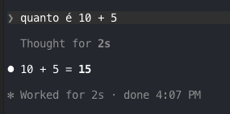
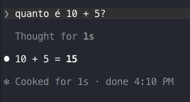

Segue por escrito a minha busca por ter um sistema perfeito de memórias e contexto para minhas aplicações de IA, de como falhei miseravelmente nessa tarefa e as lições que aprendi com isso. Contei uma longa história, mas se você quiser ver o que tenho usado como ferramenta para os meus projetos atuais, pode pular direto para a seção *Um tamanho de camisa não veste todos*

Primeiro de tudo, devo deixar bem claro que trago a minha perspectiva da ótica de uma pessoa desenvolvedora de software. Minha realidade usando IA até este momento do ano envolve planejar como transformar a estratégia das minhas clientes em blocos de código e, dentro desse processo, quebrar essa execução estratégica em tarefas, pull requests, revisões de código, testes e sistemas de *deployment* automatizado. Dentro do que virou uma revolução em velocidade para fazer tudo isso com o uso de agentes de IA, os meus desafios ganharam um escopo maior.

Em vez de cuidar de poucos repositórios e sistemas de gestão de diferentes projetos, agora me vejo gerenciando tarefas em vários repositórios, às vezes vestindo a camiseta que antes era compartilhada por times inteiros, e ainda precisando me preocupar com um escopo maior... e com o impacto do que faço ou deixo de fazer no rumo financeiro das clientes.

Diante disso e das muitas evoluções que vi ocorrendo nos últimos anos em relação a IA, comecei a desenvolver diversas soluções, como skills, automações, workflows e outros recursos com nomes pomposos e ainda não padronizados para tornar o meu uso de IA mais eficiente, barato e autônomo. Porém, desde muito cedo (2023), venho esbarrando em várias barreiras: alucinações, sistemas que funcionam bem e depois quebram, códigos impossíveis de sofrer revisão humana e seus consequentes bugs, sessões de IA com o que poderíamos chamar de *vazamento tokens*, entre outros problemas.

Daí veio um aprendizado que já estava claro desde que comecei a entender como algoritmos somados a bases de dados gigantescas seriam capazes de responder em linguagem natural, mas ao qual — embalado pelo hype — não dei a devida atenção. Refere-se à maneira como as IAs baseadas em linguagem natural operam.

> input: linguagem natural
>
> output: linguagem natural


Esse fato cria implicações muito interessantes, ainda mais para uma mente que se acostumou a transformar ideias em coisas determinísticas. Como a saída gerada por uma IA é linguagem natural, ela jamais será previsível ou determinística. *Nota: Estou delimitando como IA aquelas ferramentas baseadas em LLMs (Large Language Models), como GPT, Gemini, Claude, entre outras, da forma como o termo se popularizou nos últimos anos, em detrimento da acepção teórica*   

Exemplo: num código de programação, podemos fazer operações que sempre terão o mesmo resultado:   

```js
let sum = 5 + 10
```

No exemplo em JavaScript, `sum` sempre será igual ao numeral 15. Portanto, posso desenvolver várias lógicas sobre esse fato, consciente de que `sum` sempre entregará o mesmo resultado. Também posso programar testes que verificam essa consistência e, com isso, garantir que não haja regressões em códigos relacionados ao `sum`.

No caso das IAs, elas sempre buscarão gerar um resultado codificado para entendimento humano — seja ele texto, imagem, vídeo ou áudio. Porém, o princípio é o mesmo para os diferentes formatos. Conforme a IA começa a desenhar um resultado, ela tenta prever qual a próxima letra, pixel ou **frequência** deve ser colocada ali para que essa resposta seja compreensível para um humano. E como a linguagem humana é muito complexa, os resultados podem variar por causa das muitas nuances. Veja alguns exemplos baseado na mesma operação que fiz acima.



Em alguns casos a minha pergunta ficou diferente porque humanos variam a forma como fazem a mesmo tipo de input, e os resultados entre modelos foram ligeiramente diferentes na forma como produziram a resposta. Em termos de programação, `10 + 5 = 15` não é a mesma coisa computacional que '10 mais 5 é igual a 15'. Então, mesmo que o resultado gerado por uma IA seja interpretado como correto por nós humanos, ele não é testável, consistente e, portanto, não é confiável. Quando me peguei pensando objetivamente nesse ponto algumas das preocupações que eu tinha foram tiradas da minha lista de soluções simplesmente porque não atenderiam aos fatos das IAs.

### E se eu forçar para que o resultado seja sempre consistente com um padrão?

Além de mim, muitas outras pessoas desenvolvedoras perceberam que isso é, em suma, impossível. Uma maneira de tentar forçar um padrão de resposta é por meio de skills, ou instruções que enviamos para uma IA que podem ser executadas repetidamente. Mas as skills caem no mesmo desafio. É um input gerado por linguagem natural que recebe resposta em linguagem natural. As IAs terão a tendência de ignorar essas instruções e, de tempos em tempos, falhar. Nesse ponto do ano vejo que muitas skills são usadas de forma aparentemente eficiente mas o risco sempre estará lá.

### Dito isso, será que uma documentação também não seria ineficiente?

Sim, a premissa é a mesma. Documentações são linguagem natural e, portanto, para uma IA, servem tanto quanto um *prompt*, uma *skill* ou qualquer outra forma de instrução que adotemos. E podem ser ignoradas a qualquer momento. Documentações também podem ter contradições tanto as geradas por humanos como as geradas por IAs. Mesmo assim vários modelos se beneficiam de certa forma de ter documentações como fonte de memória adicional para ajudá-los a ir na direção correta do que é recebido como input. 

## Por que buscar uma documentação

Formei minha opinião sobre documentações a partir de empresas que estruturavam suas operações com metodologias tradicionais. Dentro de um projeto com escopo definido e claro as documentações surgem como forma definitiva de determinar como aquela operação deveria ser realizada por cada colaborador. Para mim o exemplo mais claro é a construção de um prédio que segue um projeto bem definido com etapas claras e bem definidas. Dentro disso sempre houve a possibilidade de interpretação ou escrita incorreta, mas as empresas compensavam o risco utilizando colaboradores devidamente formados para essas tarefas e responsabilizados tanto pela construção como por seguir as documentações.

Um grande passo na contramão disso foi a metodologia ágil. Ela foi desenhada para projetos de **escopos abertos**, que evoluem conforme o projeto avança e cujos objetivos mudam ao longo do tempo. É só pensar no seu aplicativo de rede social favorito e lembrar o quanto ele mudou ao longo dos anos. Mesmo assim vejo empresas insistindo no uso de documentações seja pelo apego à metodologias já usadas há muito tempo ou mesmo para lidar com os silos de conhecimento.

### O problema moderno dos silos de conhecimento.

Me acostumei com o fato de determinadas informações estarem apenas na mente de uma pessoa *owner* de produto, de *design*, de direção, *C-level*, outras desenvolvedoras, QAs — e me perdoem as pessoas cujos papéis não foram citados. Em muitos projetos uma das demandas da pessoa desenvolvedora é acessar esses dados que muitas vezes estão na mente de uma pessoa, escrita em ferramentas de documentação, em outros tipos de arquivo, limpar todos esses dados e construir um fluxograma claro do que precisa ser feito para atingir qual objetivo.

Muitas empresas passaram a operar com o ágil e com forte documentação na busca de pegar os silos de conhecimento e colocá-los por escrito de forma organizada e acessível. E isso se mostra muito desafiador há anos. Na natureza do ágil, os escopos, os objetivos e as prioridades mudam muito rápido, logo, ter uma documentação longa e detalhada cria uma demanda de atualização muitas vezes insustentável. 

Aí vieram as IAs e o trabalho não ficou mais simples. Por vezes as IAs inventam dados, escrevem demais e são redundantes. Não conheço ninguém que leia de verdade textos longos gerados por IA que dirá documentações.

## Gerenciando escopos e personas

Outro desafio das documentações é o estilo de linguagem e o nível de detalhamento. Quem lerá essa documentação? Pessoas em papéis diferentes têm demandas diferentes por informação: uma desenvolvedora precisa de insumos diferentes de uma *designer*. Qual o escopo que essa documentação deve ter? Será usada como base para desenvolvimento de novos projetos? Migração de projetos legados? Expandir projetos atuais... As possibilidades crescem, muitas vezes se misturam e a prática comum que eu vejo é documentações menores, como desenhos técnicos para cobrir entregas menores e uma depreciação natural de documentações mais antigas. Agora pense numa IA tentando acessar esses dados e gerenciar esse tipo de informação. 

## O paradigma da documentação

Tudo isso ao longo dos anos me levou a um estado semi-inconsciente de conviver com documentações, mas naturalmente fazendo uma busca manual e intensa pelos dados necessários para atuar nos meus projetos. Por um lado a natureza dinâmica de criar softwares busca o mínimo de documentações. (Já ouvi várias colegas falarem que um código bem escrito é melhor do que qualquer documentação.) Por outro lado vejo a necessidade de ter documentos claros e completos para executar projetos menores, além de informações generalistas e estratégicas para fazer com esses projetos não saiam do rumo.

Esses paradigmas têm acompanhado o desenvolvimento com agentes de IA, já que eles esbarram ainda mais rápido nos mesmos problemas que eu enfrento há anos.
Logo virou uma prioridade para mim tentar lidar com esse paradigma para que as IAs tivessem resultados melhores do que eu. Apostei no SPEC-Driven-Development que é basicamente tentar forçar as IAs a seguirem uma documentação e várias outras variantes. Já vou direto para parte onde deu tudo errado.

## *Harness* x Acompanhar mudanças nos modelos

Ao tentar criar ecossistemas onde os agentes de IA teriam acesso a inúmeras ferramentas, *skills*, sistemas de *guardrails* e especificações, esbarrei várias vezes num *harness* extremamente complexo e ineficiente. Também por vezes os novos modelos que agora surgem com frequência semanal alteram muito os resultados dos mesmos ecossistemas, as vezes parecendo se adaptar melhor, pior. Eu tenho um exemplo recente de resultados muito satisfatórios usando Claude Opus 4.8 e tendo resultados muito verbosos com o Opus 5. Para mim tão importante quanto ter um ecossistema de IA pronto para executar as tarefas necessárias, virou a necessidade de detectar e usar agentes que tenham o melhor custo-benefício para cada tarefa.

## The Bitter Lesson

O outro problema é bem descrito na famosa *Bitter Lesson:* [https://www.wikiwand.com/en/Bitter_lesson](https://www.wikiwand.com/en/Bitter_lesson). A "lição amarga" dessa observação é que muitas vezes as IAs pioram os resultados quando apostamos excessivamente no antropomorfismo do modelo. Traduzindo: quanto mais humanizados os dados estiverem, a tendência é para um pior desempenho. E basicamente a idéia de criar documentações gera exatamente esse tipo de problema. Vi cenários onde foi usado IA para gerar documentações extremamente detalhadas e complexas e os agentes de IA simplesmente se mostraram incapazes de lidar com tanta informação. Ferramentas compactadoras cresceram em uso e acredito que parte desse crescimento se deve justamente ao Bitter Lesson. O grande desafio para mim é: como estruturar dados de negócios das clientes de forma que pessoas em diferentes papéis possam construí-los, entendê-los e, ao mesmo tempo, fornecer um *input* o mais determinístico possível — e o menos humanizado em linguagem natural — para as IAs?

Aqui um pensamento, ferramentas como JEV me parecem promissoras por saírem do fluxo de entrada: linguagem natural, saída: linguagem natural. No caso do JEV a saída é determinística em formato, mesmo que a consistência dos dados não seja determinística de fato, ainda assim permite a criação de testes e engenharia por cima dos resultados. Será que em breve teremos sistemas que recebem inputs puramente determinísticos? Ou mesmo um modelo de alta capacidade processando informações que entram e saiam determinísticas (estou sugerindo algo na linha de machine learning com potência de LLM)?

Dentro dessa linha acredito que ainda temos muito o que evoluir, estudar e desenvolver independente do hype.

## Um tamanho de camisa não veste todos

Finalizando, sempre acho importante ponderar em cima da famosa frase: *One size doesn't fit all.* Logo vou simplificar uma lista do que tenho usado nos meus clientes e experimentos, dado o contexto deles, o meu contexto e recursos. Não significa que todos os projetos deveriam usar isso, e as tecnologias estão mudando o tempo todo então você viajante do futuro provavelmente verá coisas muito mais modernas do que essas a sua volta:

- SPEC Driven Development - para projetos pequenos
- Documentações em Git usando Open Knowledge Format - [https://cloud.google.com/blog/products/data-analytics/how-the-open-knowledge-format-can-improve-data-sharing](https://cloud.google.com/blog/products/data-analytics/how-the-open-knowledge-format-can-improve-data-sharing)
- Decision Logs atrelados aos workflows
- JEV/Laya para criar benchmark testes específicos para cada projeto
- Guardrails Determinísticos - lints, cis, e busca por ferramentas que operam no baixo nível com IAs